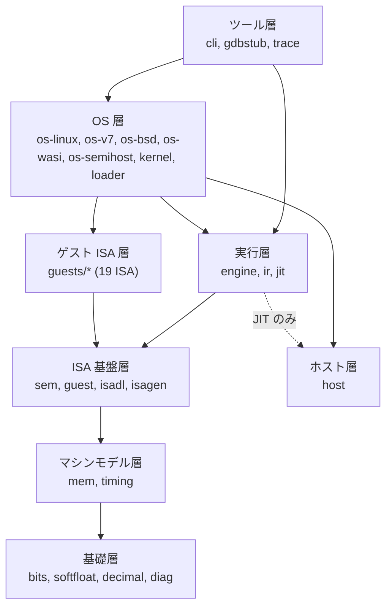

# アーキテクチャ概要

polyisa は、19 の CPU アーキテクチャ向けにビルドされたユーザープログラムを、外部クレートに依存しない単一の Rust エミュレータで実行する。現行の主流 ISA（x86-64、AArch64、RISC-V 等）に加え、歴史的な ISA（PDP-11、VAX、m68k、MIPS I 等）や VLIW/EPIC 系（IA-64、Hexagon）、スタックマシン（WebAssembly）までを同じ枠組みで扱う。

各 ISA の現在の対応状況は [実装状況](../status.md) と [対応 ISA 一覧](../guests/README.md) に、アーキテクチャ横断の未実装・暫定課題は [横断的な未実装・暫定課題](../known-issues.md) にまとめている。

## 目的と対象範囲

polyisa は、次の二つの問いに答える道具として設計されている。

1. あるバイナリが特定の CPU モデル上で正しく動くか。命令の有無やモデル固有の挙動差を含めて検証できる。
2. あるバイナリが特定の CPU モデル上で何サイクルかかるか。CPU モデルごとに宣言した忠実度の範囲で仮想時間を数える。

### 対象とする範囲

- **外部依存ゼロの Rust 実装**：`dependencies`・`dev-dependencies`・`build-dependencies`・開発用ツール（`tools/devtool`）のすべてで外部クレートを使わない。標準ライブラリにない OS 機能は `host` クレートに自前の FFI 宣言を置く。
- **19 の ISA ファミリ**：x86、ARM（AArch32 以前）、AArch64、MIPS、RISC-V、Power、s390、WebAssembly、m68k、VAX、PDP-11、SPARC、Alpha、PA-RISC、SuperH、LoongArch、OpenRISC、IA-64、Hexagon。
- **実行時の CPU モデル選択**：ISA のバージョン、拡張、世代差を機能集合・挙動パラメータ・識別情報として表現し、実行時に `--cpu` で選択する。
- **ユーザーモードと複数 OS パーソナリティ**：OS サービスはプロセス内の仮想カーネルと OS パーソナリティ（Linux、Unix V7、4.3BSD、WASI、Semihosting）が提供する。
- **共通意味論からのインタプリタと JIT**：命令意味論をバックエンドトレイトに対して総称的に一度だけ書き、インタプリタと IR/JIT で共有する。
- **ホストの移植性**：主ホストは Linux x86_64 だが、ホスト依存コードを `host`（および JIT バックエンド）に隔離し、32 ビット・ビッグエンディアン・wasm32-wasi ホストでもビルド・実行できる構造を保つ。

### 対象外とする範囲

- **システムモード**：特権命令の完全な振る舞い、ハードウェア MMU のページテーブル走査、割り込みコントローラや周辺デバイス、OS カーネルやファームウェアの起動。ただし、CPU 状態とメモリアクセスの抽象は将来の拡張を妨げない形にしている。
- **外部ライブラリとしての公開 API**：Unicorn 相当の組み込み API は提供しない。テスト用の OS なし実行環境（`BareEnv`）は内部利用に限る。
- **8 ビットバイト単位でアドレス付けしない機種や 8 ビットマイコン**：メモリモデルは 8 ビットバイトのアドレス空間を前提とする。
- **グラフィカル出力**。

## 層構造

ワークスペースは 8 つの層に分かれ、クレート間の依存は上位層から下位層への一方向に限る。

各層の責務は次のとおりである。クレート単位の詳細と依存許可表は [ワークスペース構成](workspace.md) に定める。

- **基礎層**：ビット操作、ソフトウェア浮動小数点、十進演算、内部診断ログを提供する。ISA にも OS にも依存しない。
- **マシンモデル層**：ゲストの仮想アドレス空間（ソフトウェアページ表）とタイミングモデルを、ISA に依存しない形で提供する。
- **ISA 基盤層**：Rust DSL による ISA 仕様モデル（`isadl`）、コード生成器（`isagen`）、命令意味論のバックエンドトレイト（`sem`）、ゲスト共通トレイト（`guest`）を提供する。
- **ゲスト ISA 層**：ISA ごとの仕様記述、CPU 状態、命令意味論、専用タイミング表を持つ。OS の規約には依存しない。
- **実行層**：インタプリタ、実行ループの駆動、SSA 中間表現、x86-64 ホスト向け JIT を提供する。
- **OS 層**：実行ファイルローダ、仮想カーネル、各種 OS パーソナリティを提供する。システムコール番号やシグナルフレームなど「OS × ISA」に固有の要素は OS パーソナリティ側に置く。
- **ホスト層**：実行可能メモリ、ソケット FFI、端末制御などホスト OS 固有の機能を安全な API で包む。
- **ツール層**：`polyisa` コマンド、命令トレース整形、GDB リモートシリアルプロトコルサーバを提供する。

## 実行の流れ

`polyisa run` によるゲストプログラムの実行は次の手順で進む。

1. `cli` がファイル先頭（ELF・a.out・Wasm）と `--cpu`・`--os`・`--root`・`-g` オプションから対象の ISA・CPU モデル・OS パーソナリティを決定する。
2. `loader` が実行ファイル（ELF または a.out）を解析し、セグメント配置とエントリポイントを取り出す（WebAssembly は `guests/wasm` がモジュールを検証・ロードする）。
3. OS パーソナリティがアドレス空間へセグメントと動的リンカ（`PT_INTERP`）を配置し、ABI 規約どおりの初期スタック・補助ベクタ・レジスタを構築する。
4. `engine::run` がステップ実行ループを駆動し、ISA ごとの `step` 関数が命令フェッチ・デコード・意味論実行を行う。JIT が有効（`POLYISA_JIT` 指定、対応 ISA に限る）な場合、ホットブロックを IR 経由で x86-64 機械語へ変換して実行する。
5. システムコールや CPU 例外が起きると、トラップ境界（`TrapHandler` 等）を通して OS パーソナリティが処理し、終了または未実装到達で `Outcome` を返す。

## 設計原則

個々の設計判断が衝突するときは、次の原則を優先する。

1. **ISA 固有知識の隔離**：ゲスト ISA 固有の知識は `guests/<isa>` と OS パーソナリティ内の ABI モジュールに閉じる。`engine` と `kernel` は特定のゲスト ISA 名を含まない（`jit` のホストバックエンドのみホスト ISA 名を持つ）。
2. **命令意味論の単一記述**：命令の意味は `Backend` トレイトに対して一度だけ書き、インタプリタと IR/JIT で共有する（[命令意味論・実行エンジン・JIT](execution.md)）。
3. **静的事実の宣言的記述**：エンコーディング、構文、機能、CPU モデルは `isadl::Model` の Rust DSL に集約し、`build.rs` 経由で `isagen` からデコーダ・エンコーダ・逆アセンブラを生成する（[ISA 記述とコード生成](isadl.md)）。
4. **CPU モデル差のデコード時解決**：命令の有無やエンコーディングの差は実行時分岐ではなくデコード時に解決する（[CPU モデルとバージョン](cpu-models.md)）。
5. **機能とタイミングの分離**：命令の機能実行とサイクル数計算を分離し、命令イベントで接続する（[タイミングモデル](timing.md)）。
6. **決定性の優先**：既定では同じ入力と設定から同じ実行結果と仮想時間を得る。単一ホストスレッドでのゲストスレッド多重化とソフトウェア浮動小数点はこの原則に基づく。
7. **ホスト依存の局所化**：標準ライブラリで書けるものは標準ライブラリを使い、ホスト OS やホスト CPU への依存は `host` と `jit` のバックエンドに限定する（[ホスト抽象化](host.md)）。
