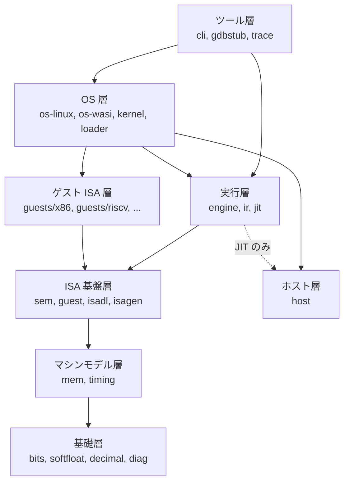

# polyisa 設計概要

この文書は polyisa の目的、要件、非目標、全体構成を定める。各サブシステムの詳細は個別の設計文書に、設計判断の理由と却下した代替案は ADR に置く。文書の一覧と読む順序は [文書の一覧](../README.md) にある。用語は [用語集](glossary.md) で定義する。

## polyisa が実行するもの

polyisa は、多数の CPU アーキテクチャ向けに作られたユーザープログラムを、Rust で書いた単一のエミュレータ上で実行する。対象は x86-64 や AArch64 のような現行の ISA に限らず、MIPS I や PDP-11 のような古い ISA、IA-64 や Hexagon のような VLIW/EPIC 系の ISA まで含む。同じ ISA の中でも、ISA のバージョンや CPU の世代による違い（命令の有無、命令の振る舞い、実行にかかるサイクル数）を区別して再現する。

この目的から、polyisa は二つの問いに答えられる道具を目指す。一つは「このバイナリは CPU X の上で正しく動くか」であり、命令の有無や未定義動作の差まで含めて判定できることを求める。もう一つは「このバイナリは CPU X の上で何サイクルかかるか」であり、タイミングモデルの忠実度の範囲で答える。

## 要件

要件は、プロジェクトの所有者に確認した事項を出典とする。

| ID | 要件 | 関連文書 |
|---|---|---|
| R1 | Rust で実装し、外部クレートに一切依存しない。dev-dependencies と build-dependencies も含む。標準ライブラリにない OS 機能は、FFI 宣言も自前で書く | [ADR-0001](../adr/0001-no-external-crates.md) |
| R2 | 主対象は x86（16/32/64 ビット）、ARM（AArch32 以前）、AArch64、MIPS、RISC-V、Power、s390、WebAssembly とする。古い・マイナーな ISA として、m68k・VAX・PDP-11、SPARC・Alpha・PA-RISC・SuperH・LoongArch・OpenRISC、IA-64・Hexagon を対象に含める（計 19 ファミリ） | [アーキテクチャ固有の要求](arch-requirements.md) |
| R3 | ISA のバージョン、拡張、CPU の世代を区別し、それらによるグループ化を表現できる | [CPU モデル](cpu-models.md) |
| R4 | エミュレーションの形態はユーザーモードとする。ゲストのプログラムを実行し、OS のサービスをエミュレータが提供する | [ユーザーモード](user-mode.md) |
| R5 | インタプリタで正しさを先に固め、JIT を後から追加する。JIT の追加で ISA ごとの命令意味論を書き直さない | [命令意味論](semantics.md)、[実行エンジン](execution-engine.md)、[JIT](jit.md) |
| R6 | 全 CPU でサイクル単位の正確さを目標とする | [タイミングモデル](timing.md) |
| R7 | 当面のホストは Linux x86_64 とする。他の OS、他のアーキテクチャ、32 ビット、ビッグエンディアンのホストへ移植できるよう、Linux x86_64 への依存を最小にする | [ホスト抽象化](host.md) |
| R8 | ライセンスは未定とする。決まるまで、他の実装のコードを流用しない | [ADR-0009](../adr/0009-no-code-reuse-until-license.md) |
| R9 | CI を使わず、検証は開発者の手元で行う。この規模のプロジェクトでは、CI の利用枠がすぐに尽きるためである | [開発作業とローカル検証](dev-workflow.md) |
| R10 | 参照する仕様とその利用条件を一か所にまとめ、ライセンスの違反を防ぐ | [参照資料の台帳](../references.md)、[ADR-0010](../adr/0010-reference-register.md) |
| R11 | 開発作業の入口には Task を、テストの実行には cargo-nextest を使う | [開発作業とローカル検証](dev-workflow.md) |

R4 の「OS のサービス」は Linux に限らない。PDP-11 や VAX のように Linux の主流の移植が存在しない ISA では、当時の Unix のシステムコールを提供する必要がある。WebAssembly では WASI がこれにあたる。このため、OS のサービスは ISA とは独立した軸（OS パーソナリティ）として設計する。

R6 は目標であり、すべての CPU モデルで達成できるとは限らない。サイクル数を公開資料から確定できるのは、主にインオーダー実行の CPU である。アウトオブオーダー実行の世代では、分岐予測器やスケジューラの内部構造が公開されていないため、パラメータ化したマイクロアーキテクチャモデルで近似し、実機での計測で較正する。この扱いを曖昧にしないため、CPU モデルごとにタイミングの忠実度を宣言し、宣言した忠実度ごとに検証方法を変える。また、ユーザーモードではカーネル内の処理時間を再現できないので、システムコールの所要時間は CPU モデルごとの固定値として扱う。詳細は [タイミングモデル](timing.md) で定める。

R7 の移植性は、Linux x86_64 以外のホストを今すぐ動かすことを意味しない。ホストに依存するコードを一つのクレートに閉じ込め、それ以外のクレートを標準ライブラリだけで書くことで、移植の作業をそのクレートの追加実装に限定する。

## 非目標

次の事項は現時点の対象外とする。ただし、追加を妨げない境界を引く。

- システムモード（特権命令、MMU のページテーブル走査、割り込みコントローラやデバイス、ファームウェアや OS カーネルの起動）。CPU 状態とメモリアクセスの抽象は、特権状態とアドレス変換を後から足せる形にする。
- 組み込み用ライブラリとしての公開 API（Unicorn 相当）。テスト用の裸実行環境は内部に持つが、安定した外部 API としては提供しない。
- 8 ビット CPU、8 ビットバイト単位でアドレス付けしない機種（PDP-10 など）、マイコン。メモリモデルは 8 ビットバイトのアドレス空間を前提とする。
- グラフィカルな画面出力。

## 全体構成

polyisa は層構造をとり、依存は上の層から下の層への一方向に限る。

図の矢印は、層の間の主な依存だけを示す。下の層への依存は、層を飛ばしてもよい（ゲスト ISA 層は基礎層の `softfloat` を直接使う）。各層の責務は次のとおりである。クレート単位の構成と依存規則は [ワークスペース構成](workspace.md) で定める。

- 基礎層は、ビット操作、ソフトウェア浮動小数点、十進演算、polyisa 自身の診断ログを提供する。CPU にも ISA にも依存しない。
- マシンモデル層は、ゲストのメモリとタイミングモデルを、ISA に依存しない形で表現する。
- ISA 基盤層は、ISA を記述するための言語（ISADL）とコード生成器、命令意味論を書くためのバックエンドトレイト、ゲスト ISA が実装するトレイト群を提供する。
- ゲスト ISA 層は、ISA ごとに、命令のエンコーディングと CPU モデルの記述、CPU 状態、命令意味論、タイミング表を持つ。OS には依存しない。
- 実行層は、ゲスト ISA に依存しない形で、命令の実行（インタプリタ、後に JIT）を提供する。
- OS 層は、プロセス内の仮想カーネルと、その上の OS パーソナリティ（Linux、WASI など）、実行ファイルのローダを提供する。OS と ISA の組み合わせに固有の部分（システムコール番号、シグナルフレームの形式など）は OS パーソナリティ側に置く。
- ホスト層は、ホスト OS とホスト CPU に依存する機能を、標準ライブラリと自前の FFI 宣言で提供する。
- ツール層は、コマンドラインインターフェースとデバッガ接続を提供する。

## 実行の流れ

ゲストプログラムの実行は、次の順に進む。

1. コマンドラインで、実行ファイル、CPU モデル（例：`mips:r3000`）、OS パーソナリティ、タイミングの忠実度を指定する。
2. ローダが実行ファイルの形式を解析し、セグメント、エントリポイント、要求する ABI を取り出す。
3. OS パーソナリティが仮想カーネル上にゲストプロセスを作り、アドレス空間にイメージを配置し、初期スタックとレジスタを ABI の規約どおりに用意する。
4. 実行エンジンが vCPU を実行する。インタプリタはステップ（ISA が定める実行の単位）をデコードし、デコード結果をブロック単位でキャッシュして実行する。
5. ステップの実行が通常の流れを外れると、エンジンは退出の理由を呼び出し元に返す。システムコールなら OS パーソナリティが処理し、CPU 例外ならシグナルに変換し、実行予算の消費ならスケジューラが別のゲストスレッドへ切り替える。
6. タイミングモデルが有効なとき、エンジンは退役した命令ごとに命令イベントを記録し、タイミングモデルがそれを消費して仮想時間を進める。ゲストが時刻を読む命令やシステムコールは、この仮想時間を返す。

## 設計の原則

以下の原則は、個々の設計判断が衝突したときの優先順位を与える。各原則の根拠は対応する ADR にある。

1. ゲスト ISA 固有の知識はゲスト ISA 層と、OS パーソナリティのゲスト ABI ごとのモジュールに閉じる。実行層と仮想カーネルは特定のゲスト ISA の名前を含まない。JIT のホストのバックエンドだけは、ホストの ISA の名前を含む。
2. 命令の意味は一度だけ書く。インタプリタと JIT は同じ意味論のコードを別のバックエンドで実行する（[ADR-0003](../adr/0003-semantics-generic-over-backend.md)）。
3. データで書けるものはデータで書く。エンコーディング、アセンブリ構文、機能、CPU モデル、タイミング表は ISADL で記述し、Rust のコードを生成する（[ADR-0002](../adr/0002-isa-description-language.md)）。
4. CPU モデルによる差は、実行時ではなくデコード時に解決する（[ADR-0006](../adr/0006-resolve-model-differences-at-decode.md)）。
5. 機能（命令が何をするか）とタイミング（何サイクルかかるか）を分離する（[ADR-0005](../adr/0005-functional-first-timing.md)）。
6. 既定の実行は決定的にする。同じ入力と同じ設定からは、同じ命令列、同じ仮想時間、同じ出力が得られる。ホストの実時間やネットワークを使う設定は、決定性を失うことを明示して選ぶ。
7. ホストへの依存はホスト層に閉じる。それ以外のクレートは標準ライブラリだけで書き、ホストのエンディアンとポインタ幅を仮定しない（[ADR-0001](../adr/0001-no-external-crates.md)）。
