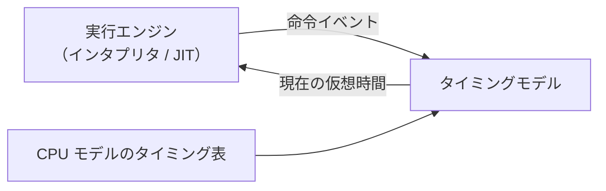

# タイミングモデル

この文書は、ゲストの命令の実行にかかるサイクル数を数える仕組みを定める。機能（命令が何をするか）とタイミング（何サイクルかかるか）を分離する理由は [ADR-0005](../adr/0005-functional-first-timing.md) にある。

## 目標と忠実度

要件 R6 は、全 CPU でサイクル単位の正確さを目標とする。この目標をどこまで達成できるかは CPU の構造と公開資料の量で決まるので、CPU モデルごとにタイミングの忠実度を宣言し、忠実度ごとに検証の方法と合格の基準を変える。

| 忠実度 | 意味 | 合格の基準 | 主な対象 |
|---|---|---|---|
| `none` | サイクルを数えない。仮想時間はステップ数から換算する | なし | 汎用 CPU モデル、WebAssembly |
| `cpi` | 命令の分類ごとの固定のサイクル数を足す | なし（相対比較の目安） | 初期の実装、タイミング表のない CPU モデル |
| `exact` | 公開資料か実機の計測から確定したサイクル数を、命令列に対して再現する | 検証用の命令列のすべてで、サイクル数が一致する | インオーダー実行の CPU（68000、MIPS R3000、80486 など） |
| `approx` | パラメータ化したマイクロアーキテクチャモデルで近似する | 較正用のベンチマーク集で、誤差が CPU モデルごとに宣言した範囲に収まる | アウトオブオーダー実行の CPU、内部構造の資料が不足する CPU |
| `approx_uncalibrated` | `approx` のうち、較正に使う実機の計測がまだないもの | `approx` と同じ（誤差の宣言は較正までの仮の値） | 同上。較正待ちの CPU モデル |

`exact` を宣言できるのは、命令ごとのサイクル数と、パイプラインの干渉の規則が資料で確定している CPU に限る。アウトオブオーダー実行の CPU では、分岐予測器、命令スケジューラ、メモリの依存予測、プリフェッチの内部構造が公開されておらず、プログラム全体のサイクル数をビット単位の命令列から確定させる方法がない。これらの CPU には `approx` を宣言し、誤差の範囲を明示する。

`approx` の CPU モデルで、較正に使う実機の計測を行えていないものは、忠実度を `approx_uncalibrated` とし、`cpus` の一覧で「未較正」と表示する。

## ユーザーモードでのサイクル数の範囲

ユーザーモードでは、polyisa が実行するのはゲストのユーザー空間の命令だけである。カーネルの処理、割り込み、他のプロセスによるキャッシュの汚染は存在しない。そこで、サイクル数の範囲を次のように定める。

- ユーザー空間の命令の実行は、タイミングモデルで数える。
- システムコールは、システムコールの種類ごとの固定のサイクル数として数える。値は CPU モデルのタイミング表に置き、既定値は 0 とする。
- 物理アドレスでインデックスされるキャッシュの振る舞いは、ページフレームの識別子から作った仮の物理アドレスで近似する。実機のページの割り当てによるキャッシュの競合は再現しない。

## 構成

タイミングモデルは、機能の実行が退役させた命令の列を、命令イベントとして受け取る。



タイミングモデルから機能の実行への情報の流れは、現在の仮想時間の読み出しだけである。ゲストが時刻を読む命令（x86 の `RDTSC`、RISC-V の `RDCYCLE`、Power の `MFTB`、Alpha の `RPCC`、SPARC V9 の `%tick` の読み出しなど）と、時刻を返すシステムコールは、それまでの命令イベントをタイミングモデルがすべて消費した後の仮想時間を読む。この流れ以外では、タイミングは機能の結果を変えない。

この構成では、誤った投機の経路で実行された命令の影響（誤予測した経路のロードによるキャッシュの状態の変化）が見えない。`approx` のモデルでは、分岐の誤予測を一定のペナルティとして扱い、誤った経路の影響は近似の誤差に含める。

## 命令イベント

命令イベントは次の情報を持つ。

| 種類 | 内容 | 出どころ |
|---|---|---|
| 静的 | タイミング表の項目（命令の分類、レイテンシ、使用する演算器、マイクロ命令への分解）、読み書きするレジスタ | デコード済みステップ（ISADL のオペランドの読み書きと、CPU モデルのタイミング表） |
| 動的 | アクセスしたアドレスと大きさと種類、分岐の成否と飛び先、例外、タイミングの手がかり | インタプリタのバックエンドが実行中に記録する |

タイミングの手がかりは、サイクル数がオペランドの値に依存する命令のために、意味論がバックエンドの `timing_hint` で渡す値である。68000 の `MULU` は乗数の 1 のビットの数でサイクル数が変わり、8086 のシフトはシフト量で、x86 の `REP MOVS` は転送量で変わる。機能の実行にしか使わない値をすべて命令イベントに含めると記録の費用が大きくなるので、タイミングに必要な値だけを意味論が明示的に渡す。

## タイミング表

CPU モデルごとのタイミング表は、ゲスト ISA クレートの `spec/timing/` に ISADL で書く。

現状の実装では、タイミング表はゲストクレートの `src/timing.rs` に Rust の定数・構成関数として置き、`ModelDef` の `timing` 句の `table` 名がその構成関数（例: riscv ゲストの `sifive_u74`）を指す。`spec/timing/` の ISADL 形式への移行は残件で、テキスト構文の整備（GAP-0006）と同じ条件で扱う。

```text
timing r3000 {
    class alu    { latency 1; }
    class load   { latency 2; }               // 結果は次の次の命令から使える
    class mult   { unit muldiv; busy 12; }    // HI/LO の読み出しは完了まで待つ
    class div    { unit muldiv; busy 35; }
    insn mult  = mult;
    insn div   = div;
    insn lw    = load;
    default    = alu;
    syscall    = 0;
    ref SPEC-MIPS-R3000 "該当する節";
}
```

オペランドの値でサイクル数が変わる命令は、Rust の関数をフックとして指定し、タイミングの手がかりからサイクル数を計算する。タイミング表には、値の出典を必ず書く。資料に基づく値は、台帳の ID と節を `ref` に書く（[参照資料の台帳](../references.md)）。polyisa の開発者が実機で計測した値は、計測の環境と方法を書いた記録をリポジトリに置き、その記録を出典とする。出典のない値は `exact` の根拠にできない。

公開されている計測データは、台帳に登録し、事実の記述（`F`）が許可された場合に限って取り込む。

## 汎用のタイミングモデル

`timing` クレートは、ISA に依存しないタイミングモデルを提供する。CPU モデルは、これらをパラメータとタイミング表で具体化する。

| モデル | 内容 | 主な用途 |
|---|---|---|
| 固定 CPI | 命令の分類ごとのサイクル数を足す | `cpi` |
| インオーダーパイプライン | レジスタごとの結果の準備時刻を持つスコアボード、演算器の占有、発行幅、発行の組み合わせの規則、分岐のペナルティ | インオーダーの `exact`（R3000、80486、Pentium の U/V パイプライン） |
| アウトオブオーダー | フロントエンドの幅、リネーム、リオーダーバッファ、命令スケジューラと実行ポート、ロード・ストアキュー、退役の幅 | `approx` |
| キャッシュ階層 | 容量、連想度、ラインサイズ、置換方式、書き込み方式、レイテンシの組を段ごとに持つ | すべてのモデルから使う |
| 分岐予測器 | 静的予測、2 ビットカウンタ、履歴を使う予測器、分岐先バッファ | 同上 |

汎用のモデルに当てはまらない CPU は、タイミングモデルのトレイトを直接実装する専用のモデルを持つ。68000 のバスサイクルとプリフェッチ、8086 のバスインターフェースユニットと命令プリフェッチキュー、VAX のマイクロコードによる実行時間がこれにあたる。

8086 の命令プリフェッチキューは、タイミングだけでなく、直後の命令を書き換える自己書き換えコードの結果にも影響する（キューに入った後の書き換えは実行に反映されない）。この現象は機能の結果を変えるので、タイミングモデルではなく、x86 の意味論とステップの構成で扱う。機能の実行とタイミングの分離を守るため、機能の結果に影響する微細構造の性質は、すべて機能の側で再現する。MIPS I のロードの遅延スロットも同じ扱いである。

## 複数のゲストスレッド

vCPU はそれぞれ自分の仮想時間を持つ。仮想カーネルのスケジューラは、仮想時間が最も小さい vCPU を次に実行する。この方法により、ゲストスレッドの実行の順序が仮想時間から決定的に決まる。

キャッシュの共有と一貫性の制御による vCPU 間の干渉は、最初の段階では扱わない。各 vCPU は自分のキャッシュ階層を持つ。共有キャッシュのモデルは、複数のゲストスレッドを使うベンチマークで誤差を評価してから導入を決める。

## 時刻の換算

仮想時間のサイクル数から時刻への換算には、CPU モデルのクロック周波数を使う。時刻を読む命令ごとに、ISA が定める計数の規則（x86 の TSC の周波数、Power のタイムベースの周波数、MIPS の Count レジスタが何サイクルごとに増えるか）を CPU モデルのパラメータとして持つ。

`clock_gettime` などの時刻のシステムコールは、既定では仮想時間から換算した時刻を返す。ホストの実時間を返す設定も用意するが、その設定では実行が決定的でなくなる。

## 検証

忠実度ごとの検証の方法は次のとおりである。

- `exact`：検証用の命令列と期待するサイクル数の組を、タイミング表の出典から作る。命令単体の組に加え、パイプラインの干渉（ロードの直後の使用、乗除算の結果の待ち、発行の組み合わせ）を含む命令列を用意する。すべての組で一致することを合格の条件とする。
- `approx`：命令ごとのレイテンシとスループット、分岐、キャッシュの各段を測るマイクロベンチマークと、実際のプログラムからなる較正用のベンチマーク集を、実機と polyisa で実行し、サイクル数を比較する。CPU モデルは許容する誤差を宣言し、宣言した範囲に収まることを合格の条件とする。

実機の計測は、計測の環境（CPU の型番、クロック、OS、計測の方法）とともに記録する。
